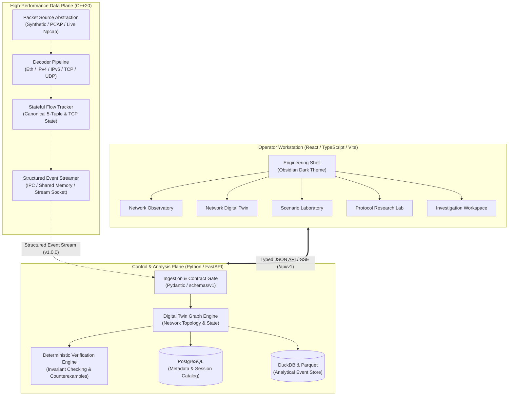

# Architecture Specification: Protocol-Aware Network Digital Twin & Security Verification Engine

## 1. System Mission & Architectural Vision

The **Protocol-Aware Network Digital Twin & Security Verification Engine** is an enterprise-grade platform combining zero-copy C++20 network telemetry, stateful flow tracking, evidence-based topology reconstruction, versioned digital twinning, and deterministic formal security property verification.

---

## 2. Component Responsibilities and Boundaries

| Subsystem | Technology | Responsibility | Dependencies |
| :--- | :--- | :--- | :--- |
| **Protocol Engine Core** | C++20, CMake | High-speed packet ingestion, header decoding, zero-copy parsing, and structured diagnostic event output. | Header-only abstractions, libpcap/Npcap (behind `IPacketSource`), `packages/contracts/cpp`. |
| **Flow & State Tracker** | C++20 | Bidirectional flow hashing, sequence reassembly, TCP state machine modeling, and session lifecycle tracking. | Protocol Engine Core. |
| **API & Control Gateway** | Python 3.11+, FastAPI | Schema enforcement, request lifecycle, health/readiness monitoring, correlation tracking, and orchestration. | `packages/contracts/python`, Pydantic Settings, PostgreSQL (optional in Phase 00). |
| **Digital Twin & Graph** | Python / Rust | Evidence-based topology reconstruction, multi-layer reachability modeling, and state delta history. | API Gateway, Analytical Store. |
| **Security Verification** | Python / SMT Solver | Deterministic invariant checking, reachability proof generation, counterfactual simulation, and counterexamples. | Digital Twin Graph. |
| **Web Workstation** | React, TypeScript, Tailwind | Professional observability workbench, live telemetry display, interactive graph inspection, and laboratory tools. | `packages/contracts/ts`, API Gateway. |

---

## 3. Dependency Direction & Invariant Rules

1. **Strict Dependency Hierarchy**:
   `Web Workstation` $\rightarrow$ `API Gateway` $\rightarrow$ `Contracts / Schemas`.
   `Protocol Engine` $\rightarrow$ `Contracts / Schemas`.
   Contracts depend on **nothing** except their canonical schema definitions.
2. **No Circular Imports**: Backend modules strictly separate routes, services, schemas, and configurations.
3. **Pluggable Packet Ingestion**: The C++ engine accesses packet data strictly through the `IPacketSource` abstraction. File-based testing requires zero elevated privileges. Live capture requires explicit authorization and driver presence.
4. **Zero Simulated Telemetry**: Missing features or inactive subsystems report explicit `planned` or `unavailable` states. No mock packet counts or synthetic vulnerabilities are fabricated.

---

## 4. Systems Engine to Python Backend Communication

In Phase 00, contracts and validation bridges are verified via HTTP API endpoints (`/api/v1/events/validate`).
For high-throughput streaming in subsequent phases:
- **Phase 01**: In-memory ring buffer and Unix Domain Socket (Linux/macOS) / Named Pipe (Windows) streaming JSONL / FlatBuffers directly from `protocol_engine` to the Python ingestion worker.
- **Phase 02+**: Zero-copy shared memory or Apache Arrow IPC stream for analytical batched ingestion into DuckDB / Parquet.

---

## 5. Structured Event Representation & Conventions

All protocol events adhere to the canonical schema `schemas/v1/network_event.schema.json`.

### Standards & Field Conventions
- **Identifiers**: UUIDv4 or UUIDv7 string.
- **Timestamps**:
  - `timestamp_ns`: Unsigned 64-bit integer representing nanoseconds since Unix epoch (UTC).
  - `timestamp_iso`: String formatted according to RFC 3339 / ISO 8601 UTC with trailing `Z`.
- **IP Addresses**: String representation normalized to canonical forms (RFC 5952 for IPv6, dot-decimal for IPv4).
- **Transport Protocols**: Explicit enum (`TCP`, `UDP`, `ICMP`, `ICMPv6`, `SCTP`, `OTHER`).
- **Absence vs. Zero**: Missing fields are represented as `null` / `std::nullopt` / `None`, distinguishing absent values from valid numeric zeroes (e.g. TCP sequence number 0 is valid; absent port is `null`).
- **Payload Privacy & Zero-Trust**:
  Raw packet payload bytes are never stored verbatim in default telemetry. Instead, payloads are represented by:
  1. `payload_length_bytes`: Integer count.
  2. `payload_hash_sha256`: Cryptographic SHA-256 hash for forensic correlation without credential retention.
  3. `sanitized_preview`: Truncated, sanitized preview string if and only if permitted by security policy.
- **Parser Diagnostics**: Any incomplete or malformed packet is accompanied by `parser_status` detailing status code (`ok`, `malformed`, `incomplete`, `checksum_error`, `truncated`), diagnostic message, and consumed byte offsets.

---

## 6. Configuration and Secrets Management

- **Zero Hardcoded Secrets**: Secrets and configurations are loaded via environment variables using `Pydantic Settings`.
- **Precedence**: Environment variables override `.env` files; `.env` overrides default fallback values.
- **Safe Defaults**: Development mode binds strictly to loopback (`127.0.0.1`), enforces local CORS policies, and runs statelessly without requiring an external database.
- **Production Guardrails**: In production (`NTWIN_ENVIRONMENT=production`), CORS requires explicit whitelists, debug mode is forced off, and authentication tokens are mandatory.

---

## 7. Quality Gates & Continuous Verification

All code changes must pass four automated quality gates:
1. **C++20 Quality Gate**: Strict compiler warnings (`/W4` on MSVC, `-Wall -Wextra -Wpedantic` on GCC/Clang), memory safety verification, and doctest unit tests.
2. **Backend Quality Gate**: Ruff formatting and linting, strict Pydantic model validation, and full pytest suite.
3. **Frontend Quality Gate**: TypeScript strict type-checking (`tsc --noEmit`), Vitest suite with DOM assertions, and production Vite compilation.
4. **Contract Hygiene Gate**: Canonical JSON Schema validation against Draft 2020-12 specification.
