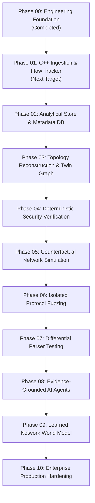

# Platform Implementation Roadmap & Measurable Exit Criteria

## Roadmap Overview

The Protocol-Aware Network Digital Twin & Security Verification Engine platform follows a rigorous, multi-phase engineering progression. Each phase builds directly upon the contracts, abstractions, and quality gates established in Phase 00.

---

## Phase Details & Measurable Exit Criteria

### Phase 00: Enterprise-Grade Engineering Foundation (Status: COMPLETED)
- **Scope**: Clean monorepo structure, C++20 engine skeleton with `IPacketSource`, FastAPI backend foundation, React/TypeScript workstation, canonical `schemas/v1` contract, quality gates, and automated test runners.
- **Exit Criteria**:
  - [x] Canonical JSON Schema v1 defined with zero-trust payload privacy.
  - [x] C++20 engine compiles cleanly (`/W4` MSVC, `-Wall -Wextra` GCC) and passes 10 unit test cases (77 assertions).
  - [x] FastAPI backend runs with correlation middleware, OpenAPI docs, and 11 passed pytest cases.
  - [x] React shell renders dark engineering workstation with live backend status and contract verifier.
  - [x] Automated CI quality gates configured.

### Phase 01: C++ Packet Ingestion, Stateful Flow Tracking & Zero-Copy Parsers (Status: NEXT)
- **Scope**:
  - Implement PCAP / PCAPNG full block decoder inside `PcapFilePacketSource`.
  - Integrate live interface capture with Npcap / libpcap C++ wrappers.
  - Implement zero-copy header decoders: Ethernet, 802.1Q VLAN, IPv4, IPv6, ARP, TCP, UDP, ICMP.
  - Implement stateful flow tracker with canonical 5-tuple hashing, bidirectional sequence tracking, and TCP state machine (LISTEN, SYN_SENT, ESTABLISHED, FIN_WAIT, etc.).
  - High-speed IPC streaming socket / ring-buffer emitting structured events conforming to `schemas/v1/network_event.schema.json`.
- **Exit Criteria**:
  - Ingest standard PCAP test fixtures (Wireshark sample captures) at >500k packets/sec.
  - Verify 100% accurate flow direction and TCP flag transitions against reference captures.
  - Stream events to Python ingestion worker over IPC socket without loss.

### Phase 02: Analytical Storage, Parquet & Relational Metadata Catalog
- **Scope**:
  - PostgreSQL schema and Alembic migration pipeline for capture sessions, devices, and audit events.
  - DuckDB integration and columnar Parquet file writer for analytical flow metrics.
- **Exit Criteria**:
  - Automated database migration and rollback tests.
  - Sub-second analytical queries over 10M packet records in DuckDB.

### Phase 03: Evidence-Based Topology Reconstruction & Digital Twin
- **Scope**:
  - Layer-2 / Layer-3 topology inference from observed ARP, DHCP, CDP/LLDP, and routing telemetry.
  - Versioned digital twin graph model tracking host discovery, interface state, and reachability.
- **Exit Criteria**:
  - Deterministic topology reconstruction matching ground-truth lab topologies.
  - Graph delta history tracking configuration drift and connection lifecycles.

### Phase 04: Deterministic Security Property Verification & Invariant Checking
- **Scope**:
  - Formal security property definition (e.g. segmentation invariants, no unauthenticated ingress, no cross-VLAN leaks).
  - Reachability verification engine generating formal proofs and concrete packet counterexamples.
- **Exit Criteria**:
  - Verified counterexample generation on injected policy violations within <2 seconds.

### Phase 05: Counterfactual Network Simulation
- **Scope**:
  - What-if scenario execution on digital twin snapshots (e.g. simulating firewall rule changes, link failures, host compromises).
- **Exit Criteria**:
  - Predictive reachability report before applying network configuration changes.

### Phase 06: Isolated Protocol Fuzzing & Mutation Engine
- **Scope**:
  - Corpus-guided mutation fuzzing targeting network protocol parsers in isolated namespaces.
- **Exit Criteria**:
  - Crash detection, ASAN integration, and reproducible artifact minimization.

### Phase 07: Differential Protocol Testing & Grammar Synthesis
- **Scope**:
  - Cross-implementation differential testing (e.g. comparing C++ engine parser against reference RFC implementations).
- **Exit Criteria**:
  - Automated detection of parser differential behavior and ambiguity resolution.

### Phase 08: Constrained, Evidence-Grounded AI Investigation Agents
- **Scope**:
  - Sandboxed investigation agents querying the digital twin graph and flow logs with strict tool boundaries and mandatory evidence grounding.
- **Exit Criteria**:
  - Zero hallucination in forensic reports: every finding must link directly to an observed `event_id` and provenance record.

### Phase 09: Learned Network World Model Evaluation
- **Scope**:
  - Experimental machine learning world models trained on flow graph dynamics, evaluated against deterministic verification baselines.
- **Exit Criteria**:
  - Quantified empirical comparison of learned vs. formal verification accuracy.

### Phase 10: Production Hardening, Multi-Tenant Operations & Enterprise Deployment
- **Scope**:
  - Role-based access control, cryptographic audit logs, high-availability deployments, and compliance certifications.
- **Exit Criteria**:
  - Comprehensive end-to-end load testing, security review, and enterprise packaging.
