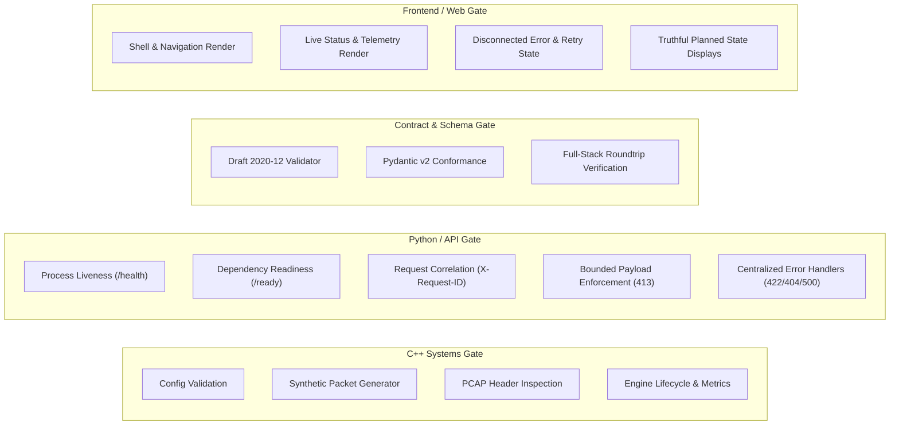

# Testing Strategy & Automated Quality Gates

## 1. Overview and Philosophy

The Protocol-Aware Network Digital Twin platform adheres to a zero-fabrication, rigorous verification philosophy:
1. **Never Report Untested Code as Passing**: If an environment lacks a prerequisite driver (e.g. Npcap live capture), the test must explicitly report the skipped/unsupported status, not fake a success.
2. **Deterministic Hermetic Tests**: Unit tests must execute offline without requiring internet access, live networks, administrative privileges, or paid external APIs.
3. **Multi-Tier Quality Gates**: Quality gates verify every layer of the platform: C++ systems, Python API, TypeScript frontend, and cross-cutting contracts.

---

## 2. Test Suites by Layer



---

## 3. Running Tests Locally

### C++ Engine Unit Tests
```bash
# Using CMake / CTest
ctest --test-dir build/engine -C Release --output-on-failure

# Or running the test runner executable directly
./build/engine/tests/Release/protocol_engine_tests.exe
```

### Python Backend Tests
```bash
# Using pytest
.\.venv\Scripts\pytest apps\api\tests

# Linting and formatting checks
.\.venv\Scripts\ruff check apps/api packages/contracts/python
```

### Frontend Tests & Type Checking
```bash
# In apps/web directory
npm run test
npm run typecheck
```

### All Quality Gates Combined
```bash
# Root task runner
make test-all
# Or on Windows PowerShell:
.\scripts\dev.ps1 test-all
```

---

## 4. Contract Schema Invariant Verification

Contract tests verify that:
1. `schemas/v1/network_event.schema.json` is a valid Draft 2020-12 JSON Schema.
2. Every field defined in the contract (`event_id`, `timestamp_ns`, `timestamp_iso`, `source_id`, `flow_id`, `link_layer`, `network_layer`, `transport_layer`, `application_layer`, `parser_status`, `provenance`) matches across:
   - `packages/contracts/python/src/contracts/network_event.py`
   - `packages/contracts/ts/network_event.ts`
   - `packages/contracts/cpp/include/contracts/network_event.hpp`
3. Missing fields are strictly distinguished from zero values using optional wrappers.
4. Payload handling preserves zero-trust guarantees (cryptographic hash over raw byte dumps).
